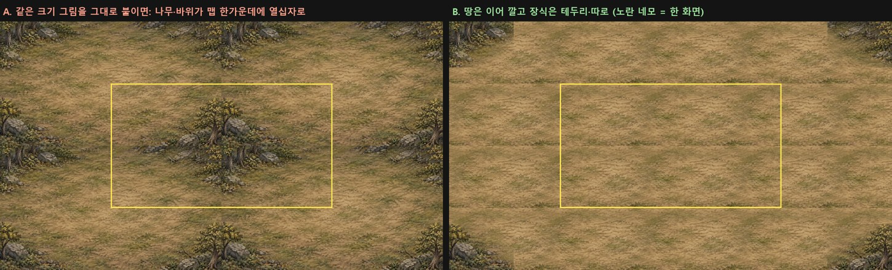

# 열전: 보스 보상과 넓은 맵 (2026-11-22 기획)

형 11-22: 「다이센카는 보물상자 연출이 난리 · 적으면 1개, 10개짜리가 터지면 동영상 수준 · 고르는 것 없이 가진 것 중 랜덤 레벨업. 다른 메가히트는 보스 보상으로 뭘 주나」 · 「맵이 너무 좁다 · 오른쪽·아래·오른쪽 아래로 같은 크기 그림을 이어 붙이면 어떨까 · 뱀서는 더 넓지 않나」

이 문서는 지금 코드를 읽고 쓴 것이다. 숫자는 시작값이고, 밸런스 봇으로 재고 고친다.

## 0. 한 줄 결론

- **상자:** 정예 상자는 「고르지 않고 터지는」 잭팟으로 바꾼다(1 · 3 · 5 · 8개 · 다이센카 틀). 고르는 맛은 중간 보스 한 번에 몰아서 크게 준다. 끝 보스는 판 밖에 남는 전리품을 준다.
- **맵:** 그림 넷을 이어 붙이지 않는다. 땅은 이어 깔리는 바닥 한 장, 나무·바위는 낱개 그림, 지금 그림은 가운데 「결전장」으로 그대로 쓴다. 넓이는 가로세로 3배(화면 아홉 장).
- **출시를 막지 않는 차례:** 새 그림 없이 되는 판을 먼저 만들고, 그림은 그 뒤에 얹는다. 그림 주문은 12장이 끝이고 다시 그리기는 한 번까지다.

## 1. 지금 무엇이 문제인가 (코드에서 확인)

### 상자
- 한 판 20분에 정예가 150초마다 나온다(6번) + 10분 중간 보스. 상자는 7개쯤 떨어진다.
- 상자를 주우면 **레벨업과 똑같은 「셋 중 하나 고르기」 창**이 뜬다(`chestOffers`). 20초 안에 잡으면 두 번 고른다.
- 레벨업이 한 판에 43번 있다. 그래서 상자 7번은 「레벨업 44~50번째」로 느껴진다. 정예를 잡은 보람이 따로 없다. 형이 「두목이 의미 없게 느껴진다」고 한 까닭이 이것이다.
- 끝 보스를 잡으면 판이 끝나고 엽전(400 × 스테이지 몫)을 받는다. 그 보스만의 것은 없다.

### 맵
- 판 크기가 1120×720, **화면 한 장**이다. 카메라는 확대했을 때만 움직인다.
- 바닥 그림은 스테이지마다 한 장(1440×810)이고, 가장자리에 나무·바위·물길·성벽이 그려진 「닫힌 마당」이다.
- 판 크기 숫자를 쓰는 파일이 17개다. 거대 보스 다섯(이무기·구미호·불가사리·백두 대호·무녀)이 모두 이 한 장 크기에 맞춰 움직임이 짜여 있다.

## 2. 다른 게임은 어떻게 하나

| 게임 | 자주 나오는 강적 | 큰 보스 | 판 밖에 남는 것 |
|---|---|---|---|
| 뱀파이어 서바이버즈 | 상자: 1·3·5개가 자동으로 오름. 가진 것만 오르고, 조건이 차면 진화가 여기서만 나옴 | 정해진 시각의 보스 상자에서 「아르카나」(판의 규칙을 바꾸는 카드)를 고름 | 업적마다 캐릭터·무기·스테이지가 열림 |
| 하데스 | 방마다 축복 셋 중 하나 | 보스 첫 격파에 귀한 재화(무기 강화용) | 무기 형태·집 꾸미기 |
| 슬레이 더 스파이어 | 정예: 유물 하나(안 고름) | 보스: 유물 셋 중 하나(세지만 값이 따름) | 카드·유물 해금 |
| 홀스 오브 토먼트 | 정예: 특성 고르기 | 보스: 장비를 떨어뜨리고, 우물로 가져가야 내 것 | 장비·축복 |
| 디아블로 | 전리품이 바닥에 쏟아짐 | 그 보스만 주는 고유 장비 | 장비 |

읽어 낼 것 셋:
1. **자주 오는 보상은 안 고른다.** 흐름을 안 끊고 연출로 터뜨린다. 뱀서·슬더스 정예가 그렇다.
2. **큰 보스는 판을 바꾸는 선택 하나를 준다.** 뱀서 아르카나, 슬더스 보스 유물.
3. **끝 보스는 판 밖에 남는 것을 준다.** 다음 판을 켤 까닭이 된다.

우리는 지금 셋 다 「카드 셋 중 하나」 한 가지다. 그래서 단계가 안 느껴진다.

### 형이 든 두 게임을 직접 읽었다 (11-22 고침)

처음 쓴 판은 「다이센카」를 모르는 채로 형 설명만 듣고 뱀서 틀로 썼다. 형이 폴더를 알려 줘서 실행하지 않고 글과 코드를 읽었다. 아래가 실제다.

**다이센카의 보물상자**
- 주우면 판이 멈추고 배경음이 꺼진다. 「열기」 단추를 누르면 상자가 흔들린다.
- 단계가 **넷**이다: 1개(연출 8.8초) · 3개(11.6초) · 5개(14.3초) · **8개(프리즈)**.
- 단계마다 **전용 음악**이 있다. 끝나면 배경음이 이어진다. 취소 키로 건너뛴다.
- 8개짜리는 파친코의 「프리즈」다. 화면이 멎고 **「눌러!」 단추가 흔들린다.** 누르면 본 연출이 터진다.
- 고르는 것은 없다. 가진 것이 오르고, 가운데 한 칸만 진화가 될 수 있다.
- 0~100 굴림에 문턱이 1 · 10 · 30 쯤이고 운 능력치가 얹힌다(가지 하나는 다 못 읽었다). 형 저장을 보면 일곱 캐릭터 클리어 중 대박이 한 번이다.
- **대박 횟수를 캐릭터 기록 화면에 남긴다.**

→ 내 첫 판의 연출 길이(1.2~3.5초)는 형이 말한 「난리」의 4분의 1도 안 됐다. 아래 3-1을 고쳤다.

**걸다이버**
- 넓은 맵을 판마다 새로 만든다. 미니맵이 있다.
- **맵에 목표가 놓인다:** 둥지 부수기 · 큰 놈 암살 · 깃발 꽂고 버티기 · 구조 · 시추기 지키기 · 포병 없애기 · 끝 보스.
- 임무 시간이 있고, 끝나면 탈출한다. 남은 시간과 난이도(10단계)가 보너스가 된다.
- 불러 쓰는 장비(기관총 · 보급 · 폭격 · 로켓 · 지뢰)가 있다.

→ 넓은 맵은 「넓기만 하면」 빈 땅이다. 갈 까닭(목표)이 같이 있어야 한다. 아래 4-6을 더했다.

## 3. 보상 설계: 세 층

### 3-1. 정예 상자 = 잭팟 (고르지 않는다)

**무엇이 오르나 (운 아님):** 지금 상자가 쓰는 차례 그대로다. ① 조건이 찬 조합(금테) ② 연 조합의 다음 단계 ③ 높은 층 기술부터. 하나 오를 때마다 다시 셈한다. 다 찼으면 엽전으로 바뀐다.
→ **조합 조건이 찼으면 상자에서 반드시 나온다.** 정예를 잡을 까닭이 생긴다.

**몇 개가 오르나 (실력이 바닥, 운이 천장 · 다이센카처럼 네 단계):**

| | 1개 | 3개 | 5개 | 8개 (대박) |
|---|---|---|---|---|
| 느리게 잡음 | 88% | 10% | 2% | 없음 |
| 빨리 잡음(지금 규칙 20초) | 없음 | 75% | 22% | 3% |

- 5개 이상이 안 터질 때마다 다음 상자의 확률이 오른다. 5개는 한 판에 한 번은 터진다. 8개는 여러 판에 한 번이다.
- 형 규칙(「전투는 운보다 통제」)에 맞춰, 빨리 잡으면 최소 3개가 **확정**이다. 운은 그 위에만 얹는다.
- 확률은 스킬 도감·일시정지 창에 %로 적는다(ODDS.md). 연출 위에는 글을 얹지 않는다.
- 운은 판의 시드 난수로만 뽑는다. 같은 판은 다시 돌려도 같다.
- **대박 횟수를 장수 기록에 남긴다**(다이센카). 「소서노 8개 대박 3번」은 남에게 말할 거리다.

**성장 총량:** 지금 상자는 판당 7~14칸을 준다. 새 표는 8~22칸이다. 레벨업 43칸과 합치면 총 성장이 10~15% 는다. 10분 중간 보스에서 상점이 낮은 판이 많이 지고 있어서, 초중반이 조금 쉬워지는 쪽은 맞는 방향이다. 봇 7무기로 재고, 넘치면 3개·5개 확률을 내린다.

**연출 (형 「WWE 오버액션」 · 있는 그림과 소리만 쓴다):**
1. 떨어짐: 상자가 툭 떨어지고(고른 소리 `fall_1`) 금빛 기둥이 선다. 화면 밖이면 가장자리에 화살표가 뜬다.
2. 주움: 0.1초 멈칫 → 판이 어두워지고 상자가 가운데로 온다. 세 번 들썩이며 북이 빨라진다.
3. 열림: 뚜껑이 터지며 빛이 솟는다. **빛 색이 개수를 먼저 알린다**(본편 유물 상자의 흔함·귀함·보배 겉빛과 같은 세 색).
4. 오름: 룬이 하나씩 솟아 HUD 칸에 박힌다(이미 있는 `pick-fly`). 박힐 때마다 북이 한 음씩 오른다.
5. 5개: 엽전이 낱낱이 분수처럼 터지고 화면 가장자리가 금빛으로 물든다. 조합이 완성되면 룬 둘이 합쳐져 금테로 바뀌는 컷이 붙는다.
- **8개 대박:** 화면이 멎고 소리가 끊긴다. 「눌러!」 단추가 흔들린다. 누르면 엽전이 화면을 덮고 룬 여덟이 차례로 박힌다.
- **단계마다 전용 음악:** 배경음을 끄고 짧은 곡을 튼 뒤 이어 준다. 곡은 형이 고른다(후보를 모아 준다).
- 길이: 1개 3초 · 3개 5초 · 5개 8초 · 8개 12초. 누르면 건너뛴다. 다이센카(8.8~14.3초)보다 짧게 잡은 까닭은 우리가 한 판에 상자를 7개쯤 열어서다.
- 저사양은 알갱이 수만 줄인다. 화면 가득한 필터 애니는 쓰지 않는다.
- 새 그림 0장: `chest.png`·`chest-open.png`·`coins.png`·룬 그림을 쓴다.

### 3-2. 중간 보스(10분) = 판을 바꾸는 선택 하나

- 중간 보스 상자만 고르는 상자로 남긴다. 한 판에 한 번이라 무게가 실린다.
- 내용: **「조합 하나를 조건 없이 바로 완성」을 셋 중에 고른다.** 내 무기의 조합(묶음·확산·갈래 끝) 가운데 아직 안 연 것 셋이 큰 카드로 뜬다. 이미 다 열었으면 한 단계 올린다.
- 새 시스템이 아니다. 있는 조합을 여는 문만 하나 더 낸다(MEGAHIT 「새 시스템 동결」 안).
- 뜻: 전반 10분은 조합을 향해 모으고, 중간 보스에서 한 방에 완성하고, 후반 10분은 그 힘으로 거대 보스까지 민다.
- 무기 정체성 작업이 조합의 꼴을 바꾸는 중이다(산 가르기·창벽·삼연격·표식 사냥). 그 작업이 끝난 조합 목록으로 붙인다.

### 3-3. 끝 거대 보스 = 판 밖에 남는 전리품

- **첫 격파 전리품:** 보스마다 하나, 본편 유물(`relics.ts`)에 다섯 칸을 더한다. 열전에서 따 와서 본편 장수가 지닌다.

| 보스 | 전리품 | 한 줄 |
|---|---|---|
| 구미호 | 여우 구슬 | 설화의 그 구슬 |
| 이무기 | 여의주 조각 | 용이 못 된 까닭 |
| 불가사리 | 쇠 먹는 이빨 | 쇠를 먹고 자란 것 |
| 백두 대호 | 범 발톱 노리개 | 호환을 막는 노리개 |
| 불의 무녀 장군 | 불탄 방울 | 굿판의 방울 |

- 다섯 다 한국 설화에서 온다. 「구미호 잡고 여우 구슬 얻었다」는 남에게 말할 수 있는 순간이다.
- 효과는 지금 유물이 쓰는 효과 종류 안에서만 고른다. 새 능력치는 만들지 않는다.
- 다시 잡으면 엽전과 「가장 빨리 잡은 기록」만 준다.
- 그림 다섯 장(유물 아이콘)이 든다. **출시 뒤로 미뤄도 되는 층이다.**

## 4. 맵 설계

### 4-1. 형 안(같은 크기 그림 넷)을 그대로 하면

- 지금 그림은 가장자리에 나무·바위가 그려진 닫힌 마당이다. 넷을 붙이면 그 장식이 **맵 한가운데에 열십자로** 모인다.
- 이어지게 새로 그리려면 넷의 맞닿는 변이 화소까지 맞아야 한다. 그림 생성으로는 장마다 따로 나와서 이음매가 남는다. 여울의 물길, 산성의 성벽은 더 어렵다.
- 다섯 스테이지 × 3장 = 15장을 맞춰 가며 다시 그리는 일은, 형이 걱정한 「무한 다시 만들기」가 되기 쉽다.

### 4-2. 대신: 세 겹으로 나눈다

1. **바닥:** 이어 깔리는 땅 한 장(스테이지마다). 지금 그림 가운데를 잘라 코드로 이음매를 없앤 판이 벌써 된다(시험 그림 오른쪽). 새 그림 없이 시작할 수 있다.
2. **낱개 장식:** 나무·바위·갈대·횃불·성벽 토막을 한 개씩 그려 코드가 놓는다(형 규칙 「낱낱이」). 몸과 같이 앞뒤 차례로 그린다. 처음엔 꾸밈이고 부딪히지 않는다.
3. **결전장:** 지금 스테이지 그림은 **맵 한가운데 한 칸에 그대로** 깐다. 가장자리를 바닥과 섞는다. 네 귀퉁이의 나무·성벽이 「빈터」의 울타리처럼 읽힌다. 승인받은 그림을 버리지 않는다.

### 4-3. 넓이와 보스

- **3×3 (3360×2160, 화면 아홉 장).** 끝에서 끝까지 걸어 18초다. 2×2는 12초라 여전히 좁다. 끝없는 맵은 하지 않는다. 스테이지마다 지형이 있고 거대 보스가 있어서다.
- **원래 한 장이 가운데 칸이다.** 좌표를 「원래 판은 0~1120 그대로, 바깥이 음수와 그 너머」로 잡는다. 그러면 **거대 보스 다섯의 코드는 한 줄도 안 고친다.**
- **보스가 오면 결전장이 닫힌다.** 나팔 → 가운데로 돌아오라는 화살표 → 안개(스테이지마다 목책·불길·눈보라)가 가운데 칸을 두른다. 엘든 링의 안개 문이다. 보스 패턴은 한 장 크기에 맞춰 짜여 있어서 밸런스도 그대로다.
- 20분 중 18분은 넓게 돌고, 보스 두 번만 좁은 데서 싸운다.

### 4-4. 넓어지면 같이 바꿔야 하는 것

| 것 | 지금 | 바꿈 |
|---|---|---|
| 카메라 | 1배에서 고정 | 늘 장수를 따라감 · 걷는 쪽을 조금 앞서 봄 · 맵 끝에서 멈춤 |
| 적이 나오는 곳 | 판 가장자리 | 화면 바로 밖 둘레 |
| 뒤처진 적 | 없음 | 화면 한 장 반 넘게 멀어지면 앞쪽 둘레로 옮김(뱀서 방식 · 한쪽으로만 달려도 밀도가 유지됨) |
| 정예 | 화면 안에 나옴 | 조금 떨어진 곳에 나오고 화살표 · 「20초」는 처음 화면에 들어온 때부터 셈 |
| 상자·보스 | 다 보임 | 화면 밖이면 가장자리 화살표 |
| 그리기 | 다 그림 | 화면에 보이는 것만 |

- 적 수 한도(230)는 그대로라 성능은 같다.
- 판 계산이 바뀌므로 새 규칙 이름으로만 켠다. 옛 판 기록은 그대로 다시 돈다.

### 4-5. 넓은 맵이 무기 정체성과 맞물리는 곳

지금 한 장짜리 판에서는 무기 정체성이 살 자리가 없다. 넓어져야 산다.
- 창 「곧게 달리면 돌격」: 곧게 달릴 길이 생긴다.
- 활 「멈춰 서면 겨눔」 · 돌팔매 「거리를 벌림」: 물러날 땅이 생긴다.
- 방울 「한자리에서 버팀」: 넓은 맵에서 혼자 안 움직이는 무기가 된다.

그래서 차례는 무기 → 맵 → 상자다. 맵 그림은 지금부터 만들어 둔다.

### 4-6. 넓은 맵에 갈 까닭: 목표 (걸다이버에서)

- 넓기만 하면 한 자리에서 도는 지금과 같다. 맵에 목표를 놓는다. 목표를 끝내면 **상자**가 나온다.
- 있는 것으로 먼저 만든다. 새 적도 새 그림도 없다.

| 목표 | 걸다이버 | 우리 것 | 이미 있는 것 |
|---|---|---|---|
| 큰 놈 사냥 | 암살 | 정예가 멀리 나오고 화살표가 뜬다 | 정예 · 상자 |
| 소굴 부수기 | 둥지 파괴 | 적이 나오는 목책 토막을 부순다 | 목책 부수기(목책 돌파 스테이지) |
| 깃발 지키기 | 깃발 꽂고 버티기 | 장승 곁에서 30초 버틴다 | 몰아침(파도) |

- 첫 판은 「큰 놈 사냥」 하나만 넣는다. 나머지 둘은 해 보고 재미있으면 더한다.
- 임무 시간 · 탈출 · 불러 쓰는 장비는 가져오지 않는다. 우리 판은 20분 버티기와 거대 보스가 뼈대다.

## 5. 그림 주문 (챗지피티 · 12장이 끝)

| 묶음 | 장 수 | 꼴 | 통과 기준 (숫자로) |
|---|---|---|---|
| 바닥 | 5 | 스테이지마다 1024 정사각 이어 깔리는 땅 | 코드로 3×3 깔아 이음매 차이를 잼 · 넘으면 반려 |
| 장식 | 5 | 스테이지마다 낱개 6~8개 한 장(민무늬 바탕) | 낱개로 잘림 · 한국 산천 결 · 일본·중국 결 없음 |
| 여울 물길 | 2 | 물길 이음 토막(곧은 것 · 굽은 것) | 가운데 칸 물길과 색이 이어짐 |

- 다시 그리기는 장마다 한 번까지다. 두 번째도 안 되면 코드로 만든 바닥(4-2의 1)을 그대로 쓴다.
- 유물 아이콘 5장(3-3)은 출시 뒤에 주문한다.

## 6. 차례와 출시

| 차례 | 일 | 새 그림 | 출시 전에? |
|---|---|---|---|
| 1 | 무기 정체성 (진행 중) | 0 | 예 |
| 2 | 넓은 맵 첫 판: 코드로 만든 바닥 + 가운데 결전장 + 카메라 + 적 나오는 곳 + 화살표 | 0 | 예 |
| 3 | 정예 상자 잭팟 + 연출 | 0 | 예 |
| 4 | 중간 보스 조합 고르기 | 0 | 예 |
| 5 | 맵 그림 12장 얹기 | 12 | 되는 만큼 |
| 6 | 끝 보스 전리품 5개 | 5 | 아니오 (출시 뒤) |

- 2~4는 새 그림이 0장이다. 그림 때문에 멈추는 일이 없다.
- 단계마다 형이 해 볼 수 있게 배포한다. 봇 7무기 숫자를 같이 낸다.
- 열전은 MEGAHIT의 「찍힐 화면」이다. 넓은 맵과 상자 잭팟은 예고편·숏폼에 그대로 쓰인다.

## 7. 형이 정할 것

1. **5개 잭팟에 운을 둘까.** 추천: 둔다(위 표 · 한 판에 한 번은 터짐). 운이 싫으면 「20초 안 3개 · 10초 안 5개」로 실력만으로도 된다. 터지는 맛은 운 쪽이 크다.
2. **맵 넓이.** 추천: 3×3. 걸어서 18초.
3. **보스 때 결전장을 닫을까.** 추천: 닫는다. 안 닫으면 거대 보스 다섯을 넓은 맵에 맞춰 다시 조율해야 한다.
4. **상자 연출 길이.** 추천: 3 · 5 · 8 · 12초(누르면 건너뜀). 다이센카만큼(9~14초) 길게 가도 된다.
5. **맵 목표.** 추천: 「큰 놈 사냥」 하나부터.
