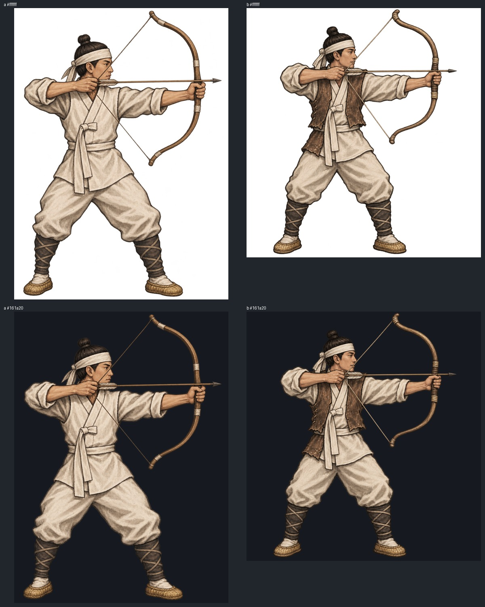

# 50-5 해적 활쏘기 캐릭터 시안

검토용 RAW 두 장이다. 게임 캐릭터·이동·공격 그림은 교체하지 않았다. 기존 몸/팔 분리 렌더에 바로 덮어쓰는 설치본이 아니다.

| 안 | 보관 원본 | 크기 | bytes | SHA256 |
|---|---|---|---:|---|
| A · 흰 베옷 | `D:/에셋창고/pirate-player-concept-a-50.png` | 1076×1462 | 1340379 | d8703ba558ade7664373d0bbc48d1429eb284ea563aec096d2f8db980c5f0cf6 |
| B · 가죽 조끼 | `D:/에셋창고/pirate-player-concept-b-50.png` | 1217×1293 | 1188186 | eda5a7321226f933a87b20177f80c979ecb9f5b2365d15f38fdd6625424ada64 |

각 물건을 새 agent 문맥에서 내장 imagegen 1회씩 생성했다. 원본 `public/sprites/hero-plain.png`와 실제 활 당기기 화면 `outputs/codex50/pirate-pull-before.png`를 직접 열어 본 뒤, 두 파일을 실제 `referenced_image_paths` 인수로 전달했다. 정확한 prompt·참조·원본 경로·도구 횟수는 `CODEX50-PIRATE-CONCEPT-a.json`, `CODEX50-PIRATE-CONCEPT-b.json`에 있다. API/CLI 생성0·재생성0·RAW 픽셀 수정0·게임 설치0이다.

root가 두 RAW와 흰/어두운 바탕의 정확한 alpha 합성을 직접 열어 전신·신발·활/화살 각1개·원래 베옷/붓질을 확인했다. RAW 뷰에서 보인 고채도 가장자리 대부분은 alpha16 미만이며 실제 합성에는 띠가 보이지 않았다. 고알파 빨강 표본은 A1픽셀/B0, 고알파 초록0이다. 이는 시안의 모든 손가락·해부학을 완전 인증한 검사가 아니다. 겹친 그립의 개별 손가락5개 전체 판독, 생성 요청의7~7.5등신·여백은 확정 합격으로 평가하지 않았다. A의 허리띠는 요청한 짙은색 대신 원래 옷과 비슷한 아이보리다. 형이 고르기 전 검토용으로 보존한다.

아래는 RAW를 바꾸지 않고 alpha를 합성한 검수용 배치판이다.

